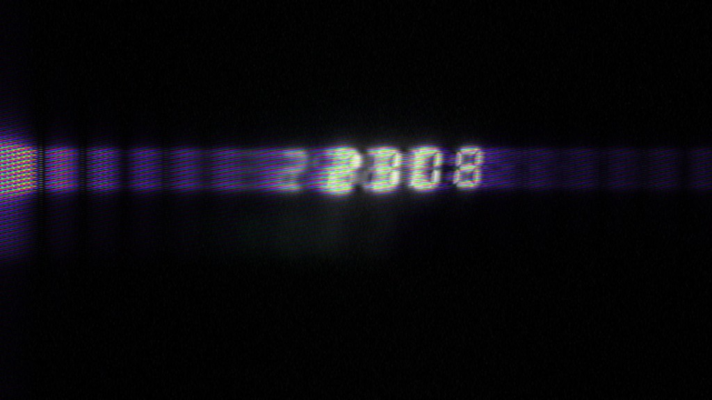

# Gleitzsch

An experimental camera and photo editor somewhere between an app and an art project.

Point, distort, keep something strange. Whatever you make is part of the project. **Random** explores the effects for you; **Custom** lets you take control.

No AI, just decades-old signal-processing algorithms running on your phone’s CPU and GPU. Images stay on your device. Special thanks to Fourier for the mathematics. Sorry about what we're doing with it.

In development for **iOS and Android**. An early **Android alpha 4.8.0** is available as a direct APK download: **29.2 MB · Android 10+ · ARM64**. It is not on Google Play yet; registration, more polished builds and Play testing are next. Video is currently silent, and Pixelate can be slow. See [downloads and current availability](https://kirilenkobm.github.io/gleitzsch-site/index.html#availability).

[Visit the Gleitzsch website](https://kirilenkobm.github.io/gleitzsch-site/index.html).

This repository hosts the website and collects [issues and feedback](https://github.com/kirilenkobm/gleitzsch-site/issues). For private support or privacy questions, [email me](mailto:bogdan.kirilenko+gleitzsch@proton.me).

Thanks to **Codex** for helping me express what I feel in code, and to **Cursor** for helping along the way.

---

© 2026 Bogdan Kirilenko. Made with 🔮 in Berlin.
