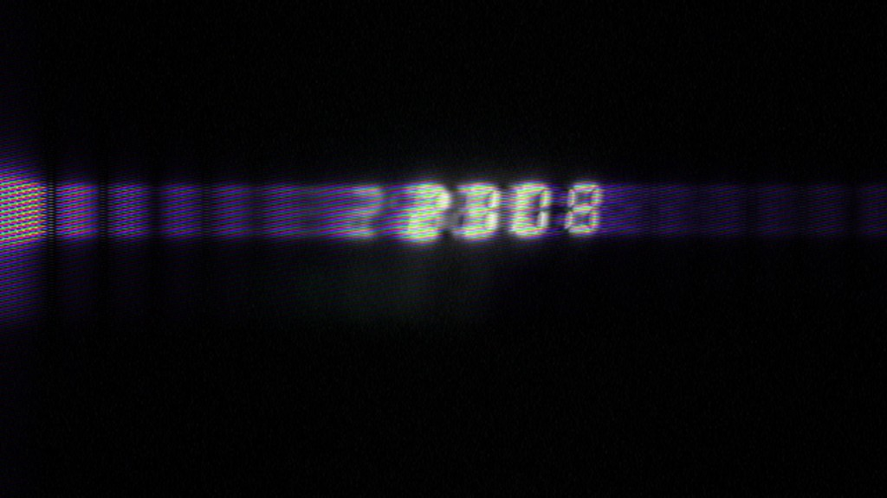

# Gleitzsch

[Visit the Gleitzsch website ↗](https://kirilenkobm.github.io/gleitzsch-site/index.html)

An iPhone camera somewhere between an app and an art project. No AI. Just algorithmic mischief.

Anyone with an iPhone can be part of it: point, distort, keep something strange. The pictures you make are part of the project. Random wanders through the effects. Custom lets you stop it when you find something you like.

Thanks, Fourier, for the series and transforms. Sorry about what we’re doing with them. All image effects run on your iPhone using decades-old signal-processing maths, with help from Apple’s Metal, Accelerate and the GPU.

This repository hosts the project’s GitHub Pages website and collects [issues and feedback](https://github.com/kirilenkobm/gleitzsch-site/issues).

For private support or privacy questions: [email Bogdan](mailto:bogdan.kirilenko+gleitzsch@proton.me).

Made with 🔮 in Berlin.

Thanks to Codex for helping me turn what I feel into code, and to Cursor for a hand here and there.

— [Bogdan](https://github.com/kirilenkobm)

---

© 2026 Bogdan Kirilenko.
